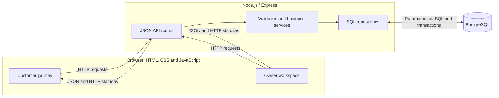
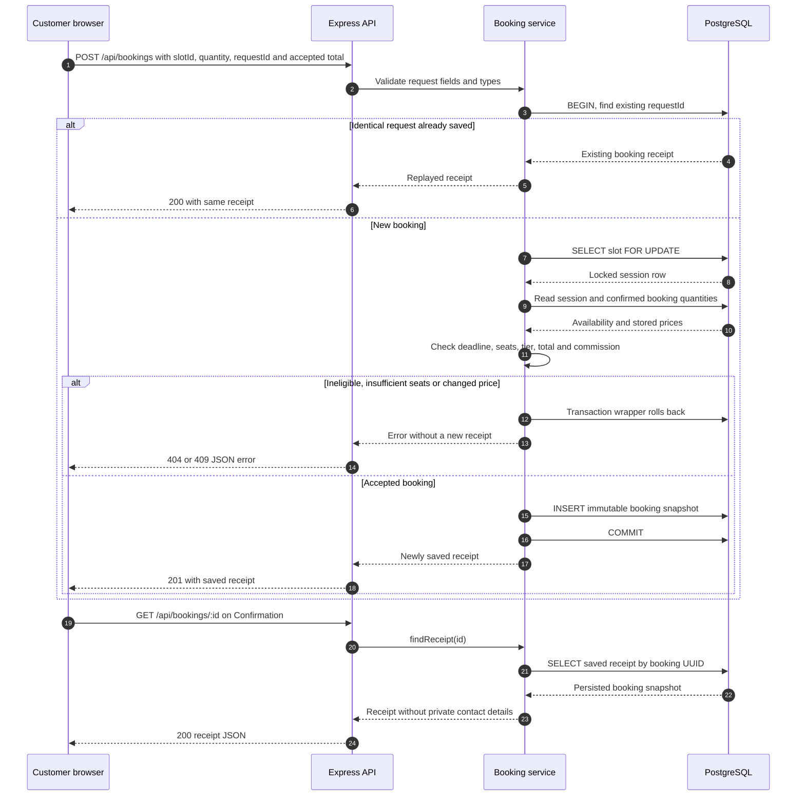

# SlotDrop system and data flow

SlotDrop connects a browser-based customer journey to an Express API and PostgreSQL. Sessions, bookings and payments are course-demo records; they do not reserve real studio inventory.

The pages in [public/](../public/) fetch JSON. [Express routes](../server/routes/) handle HTTP, [services](../server/services/) validate inputs and enforce rules, and [repositories](../server/repositories/) run PostgreSQL queries and transactions. The booking service uses a repository transaction to take the session row lock and save the receipt. Use fictional data in the public Owner workspace.

## Transaction: choose, quote, save, read back

**Short data flow:** A customer chooses a session and quantity, requests a fresh server quote, then submits the accepted amount with a stable request ID. The server locks the session, rechecks seats and price, saves one PostgreSQL booking, and returns its receipt ID. Confirmation reads that stored receipt by ID, while Owner independently reads saved bookings and aggregated metrics.

| Hop | Code location | Behavior |
|---|---|---|
| 1. Browse | Home and Browse interface → `GET /api/slots` | Requests eligible sessions. Browse sends search text, activity type, date/group-size filters and pagination to the list API |
| 2. Discover | `server/routes/slots.js` → `listSlots()` in `server/services/discovery.js` → `searchSlots()` in `server/repositories/slots.js` | The service validates filters. The repository applies them and uses the same confirmed-seat count for filtering and rendering. Scheduled sessions follow the 72-hour window and cutoff. |
| 3. Choose | `public/js/detail.js` and `public/js/selection.js` | Fetches detail and quantity-aware quote; displays the selected session and party price |
| 4. Quote | `server/routes/pricing.js` → `server/services/pricing.js` | Validates session and quantity; selects standard or buddy tier stored in DB, never browser money |
| 5. Submit | Checkout submit → `retryLimitedBooking()` → `request()` in `public/js/customer-common.js` | Sends session ID, quantity, fictional guest details, accepted quote and a stable UUID request ID |
| 6. Route | `server/routes/bookings.js` → `createBooking()` in `server/services/bookings.js` | Validates allowed fields, UUID, quantity, fictional contact fields and payment choice |
| 7. Transaction | `createBooking()`, `checkBookable()`, `priceQuote()` | Checks existing requestId; locks `slots` row with `SELECT ... FOR UPDATE`; rechecks available seats and eligibility after lock; recomputes tier/fee/total and checks expectedTotalCentavos |
| 8. Database save | `createBooking()` → SQL `INSERT INTO bookings ... RETURNING id` | Stores accepted price, time, quantity, fee and provider proceeds as immutable snapshots; commits atomic booking. Same normalized requestId returns existing receipt (HTTP 200), new booking HTTP 201 |
| 9. Receipt readback | `GET /api/bookings/:id` → `findReceipt()` | Reads saved receipt by UUID from PostgreSQL. Public payload omits private guest contact information and retry key |
| 10. Confirmation | Confirmation → `GET /api/bookings/:id` | Displays the persisted reference, activity, quantity and total by fetching the saved receipt |
| 11. Owner | `GET /api/bookings`, `GET /api/metrics` → `public/js/owner.js` | Reads saved booking list and five metrics from persisted confirmed bookings; a two-seat order counts as one booking |

### Booking sequence and transaction boundary

The row lock serializes competing holds, bookings and Owner capacity edits for the **same** slot. Confirmed booking quantities and unexpired active holds determine available allocation. A submitted quote is only a price acknowledgement: the server recomputes it after acquiring the lock. If the total changed, the API returns a fresh quote with `409 PRICE_CHANGED`; it does not save the order.

### Data boundaries and outcomes

| Data or decision | Authoritative source | What the browser receives |
|---|---|---|
| Activity and studio information | `providers` and `services` tables | Public activity, studio and inclusion details |
| Dated offer, booking cutoff, released capacity, prices | `slots` table | Eligible listings and a fresh session/price quote |
| Remaining allocation | Slot capacity minus confirmed bookings and unexpired active holds | Derived `remainingSeats`, plus separate `confirmedSeats` and `heldSeats` |
| Booking result | `bookings` record: session, quantity, accepted tier, fee, payout and timestamp | Receipt read by ID; guest email/name and requestId remain server-side |
| Owner reports | Confirmed saved booking rows and session eligibility | Booking list without contact information and five derived metrics |
| Provider inquiries | `provider_applications` table, separate from checkout | Pending application ID/status, not automatic listing approval |

| Scenario | HTTP response | Persistence consequence |
|---|---|---|
| New valid booking | `201` | One saved confirmed booking |
| Identical retry with the same requestId | `200` | Original receipt, no second booking |
| Invalid input or unknown body field | `400` | Nothing saved |
| Unknown slot or booking ID | `404` | Nothing saved or returned |
| Sold-out/closed session, stale price or conflicting retry key | `409` | No new booking |
| Booking rate exceeded | `429` | Checkout waits and retries the same request ID. |
| Recognized database outage | `503` | No success receipt reported |

The payment options are simulated and no card is charged. This architecture illustrates the Group 1 code path, not external supplier inventory synchronization.

Prices are integer centavos. [Shared pricing helpers](../public/js/business-config.js) apply the same tier and rounding rules in quotes, booking and previews. The server reads the commission rate from [one setting](../server/config/business.js). A hold temporarily reduces availability. Only a confirmed booking contributes to orders, revenue and average order value.

## Owner offer-management path

1. `public/js/owner.js` sends `POST /api/slots` or `PATCH /api/slots/:id`; edits send only changed fields.
2. `server/routes/slots.js` calls `createOffer()` or `editOffer()` in `server/services/offers.js`.
3. The service validates cutoff/price/capacity, locks the relevant activity or slot and refuses edits conflicting with confirmed or actively held seats.
4. `server/repositories/slots.js` returns the updated offer and available-seat count.
5. Owner refreshes catalog, metrics and saved bookings. Prior confirmed receipts are not rewritten by later offers.

## Persistence and deployment boundary

Production-mode Node.js reads `DATABASE_URL` from its environment and uses the `pg` connection pool. `server/repositories/database.js` wraps booking operations in PostgreSQL `BEGIN`/`COMMIT` or `ROLLBACK`. Render, Vercel and the local demo use `server/repositories/migrations.js` for database setup. It seeds an empty database in one transaction and applies additive upgrades before the reference catalog is checked. Saved bookings remain in PostgreSQL across web-server restarts.

The local `npm run demo` uses a separate PGlite database for development. Production health checks database reachability and required tables. The [deployed booking trace](challenges.md#challenge-2-trace-one-real-request) and [PostgreSQL restart check](https://github.com/Frannaaa/slotdrop-gc2/actions/runs/43666651287) verify separate parts of the persistence path. [Database schema](schema.md) and [API contracts](routes.md) hold the field-level details.

## Final upgrade: hold backend foundation

`POST /api/holds` reaches `holdRouter()`, then `createHold()`. The service validates the retry key and selection, locks the session row, reads the server time and shared availability, and stores a hold expiring at the earlier of ten minutes and the session cutoff. Identical retries read the existing state. `GET` reports active/expired/released/converted status; `DELETE` releases an active hold under the same lock order.

`slotSelect()` in `server/repositories/slots.js` counts both confirmed bookings and unexpired active holds. Browse, Detail, quotes, ordinary booking saves, Owner and low-stock metrics use this query. A hold changes availability, while orders/revenue/AOV still use saved confirmed bookings only. Owner edits cannot reduce capacity below the combined reservations.

Expiry is enforced by persisted timestamps and the server query, including after reopening the database with no browser running. The browser countdown and atomic conversion into a booking remain teammate integration tasks. Their required lock order and shared helpers are in the [route handoff](routes.md#seat-holds-and-teammate-handoff). The existing GC2 customer journey remains usable in the foundation branch.

The prepared [health pinger](../.github/workflows/keep-awake.yml) requests the live `/api/health` route on a ten-minute schedule after merge. GitHub can delay scheduled runs, so open the app before presenting and verify actual successful checks. This does not by itself prove the upgrade is deployed.

