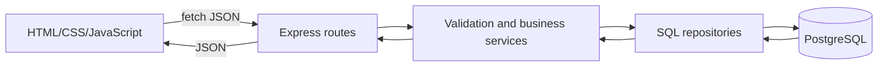

# System and data flow

## Working offer flow

1. The form handler in public/js/owner.js sends POST /api/slots or PATCH /api/slots/:id. Edits include only changed fields.
2. server/routes/slots.js calls createOffer() or editOffer() in server/services/offers.js.
3. Creation validates the offer, locks the activity, resolves its booking deadline and inserts the session. Editing locks the session, counts confirmed seats and checks the requested changes.
4. server/repositories/slots.js returns the saved session, provider details and remaining seats.
5. The page refreshes catalog, metrics and saved bookings in parallel.

Discovery uses listSlots() in server/services/discovery.js. Its time, cutoff and capacity filters apply to customer results. The owner catalog also includes paused and expired inventory.

## Booking flow to integrate

Janelle owns quote, booking creation and receipt-by-ID. On one database client, booking must lock the same session row, recheck eligibility and seats, select the stored price tier, compute totals, compare the acknowledged amount, insert the receipt and commit. An identical retry returns the existing receipt.

The browser's price is a preview. Confirmation must read the saved booking by ID. The final Network trace and hand-drawn diagram must follow a booking through the completed public app.
