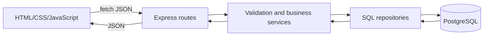

# System and data flow

## Implemented in the development PRs

The owner form in public/js/owner.js sends POST /api/slots or PATCH /api/slots/:id. server/routes/slots.js calls createOffer() or editOffer() in server/services/offers.js.

Creation validates fields and prices, reads the activity default, resolves the cutoff and inserts the session. Editing locks the session row, checks confirmed booked quantities and updates the allowed fields. Both use a database transaction. server/repositories/slots.js returns the saved session with provider details and derived remaining seats.

The owner page then loads catalog, metrics and saved bookings in parallel. Its displayed total and provider proceeds are previews; booking amounts must come from the server.

Customer discovery uses listSlots() in server/services/discovery.js. It applies cutoff, date and capacity rules. The owner catalog includes paused and expired sessions so they can still be managed.

## Booking flow still to integrate

Janelle owns quote, booking creation and receipt-by-ID. The booking transaction must lock the same session row, recheck confirmed seats, choose the stored rate, compute totals, compare the customer's acknowledged amount, insert the receipt and commit. An identical retry should return the existing receipt.

The six customer screens and these booking routes are not complete in Fran's PRs. The final Network trace and hand-drawn diagram must follow an actual deployed booking.
