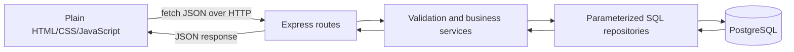

# SlotDrop system and data flow

## Fran's implemented session offer flow

1. public/js/owner.js handles the form and sends POST /api/slots or PATCH /api/slots/:id.
2. server/routes/slots.js parses the route ID and invokes createOffer or editOffer in server/services/offers.js.
3. Create validates JSON fields and prices, reads the activity, resolves the session cutoff and inserts the offer in one transaction. Edit locks the session row, counts confirmed booked seats, validates the new values and updates that session.
4. server/repositories/slots.js joins activity/provider details and derives remaining seats from confirmed saved quantities.
5. Express returns JSON. The owner page reloads catalog, metrics and bookings in parallel and renders the current data.

GET /api/slots uses server/services/discovery.js to apply provider cutoff, 72-hour discovery, date and people filters. GET /api/slots/:id can show a known unavailable session. GET /api/owner/catalog deliberately includes inventory absent from customer discovery.

## Team booking integration

The required end-to-end flow is Browse → Select → Confirm → Save → read the saved receipt by ID. Janelle owns quote, booking creation and confirmation readback. Her booking transaction must acquire the same slots-row lock before recomputing seat availability, prices and totals, inserting immutable receipt fields, and committing. A retry key prevents duplicate requests; a changed price requires reconfirmation before an insert.

Those customer transactions are not implemented by Fran's owner PRs. This system diagram documents the code interfaces; it does not replace the brief's hand-drawn diagram or actual Network-tab trace of a deployed booking.
