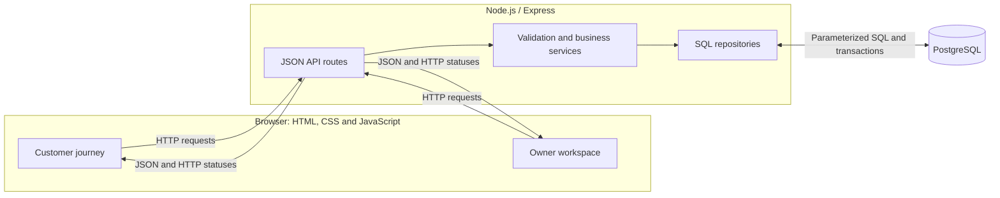
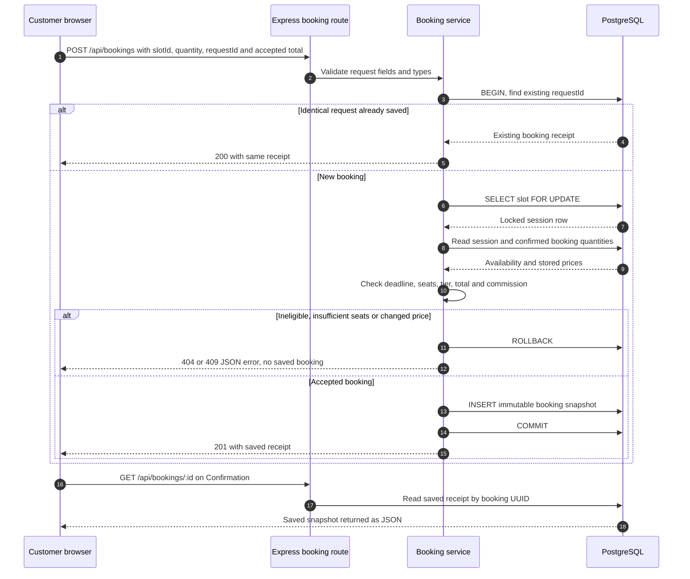

# SlotDrop system and data flow

SlotDrop connects a browser-based customer journey to an Express API and PostgreSQL. Sessions, bookings and payments are course-demo records; they do not reserve real studio inventory.

The customer and Owner pages share the same Express application and database. UI files do not query PostgreSQL directly. Express routes parse HTTP requests, services enforce booking rules, repositories execute parameterized SQL, and responses return JSON with explicit status codes. The Owner screen is a course-demo workspace without account authentication; it should only be used with fictional data.

## Transaction: choose, quote, save, read back

| Hop | Code location | Behavior |
|---|---|---|
| 1. Browse | Home and Browse interface → `GET /api/slots` | Requests eligible sessions filtered by date, area, activity or party size |
| 2. Discover | `server/routes/slots.js` → `listSlots()` in `server/services/discovery.js` → `server/repositories/slots.js` | Filters active sessions, future cutoff, remaining released seats and discovery window; returns JSON |
| 3. Choose | `public/js/detail.js` and `public/js/selection.js` | Fetches detail and quantity-aware quote; displays the selected session and party price |
| 4. Quote | `server/routes/pricing.js` → `server/services/pricing.js` | Validates session and quantity; selects standard or buddy tier stored in DB, never browser money |
| 5. Submit | Checkout → `request('/api/bookings', {method:'POST', ...})` in `public/js/customer-common.js` | Sends session ID, quantity, fictional guest details, accepted quote and a stable UUID request ID |
| 6. Route | `server/routes/bookings.js` → `createBooking()` in `server/services/bookings.js` | Validates allowed fields, UUID, quantity, fictional contact fields and payment choice |
| 7. Transaction | `createBooking()`, `checkBookable()`, `priceQuote()` | Checks existing requestId; locks `slots` row with `SELECT ... FOR UPDATE`; rechecks available seats and eligibility after lock; recomputes tier/fee/total and checks expectedTotalCentavos |
| 8. Database save | `createBooking()` → SQL `INSERT INTO bookings ... RETURNING id` | Stores accepted price, time, quantity, fee and provider proceeds as immutable snapshots; commits atomic booking. Same normalized requestId returns existing receipt (HTTP 200), new booking HTTP 201 |
| 9. Receipt readback | `GET /api/bookings/:id` → `findReceipt()` | Reads saved receipt by UUID from PostgreSQL. Public payload omits private guest contact information and retry key |
| 10. Confirmation | Confirmation → `GET /api/bookings/:id` | Displays the persisted reference, activity, quantity and total by fetching the saved receipt |
| 11. Owner | `GET /api/bookings`, `GET /api/metrics` → `public/js/owner.js` | Reads saved booking list and five metrics from persisted confirmed bookings; a two-seat order counts as one booking |

### Booking sequence and transaction boundary

The row lock serializes competing bookings and Owner capacity edits for the **same** slot. Confirmed booking quantities, not a mutable remaining-seat counter, determine available allocation. A submitted quote is only a price acknowledgement: the server recomputes it after acquiring the lock. If the total changed, the API returns a fresh quote with `409 PRICE_CHANGED`; it does not save the order.

### Data boundaries and outcomes

| Data or decision | Authoritative source | What the browser receives |
|---|---|---|
| Activity and studio information | `providers` and `services` tables | Public activity, studio and inclusion details |
| Dated offer, booking cutoff, released capacity, prices | `slots` table | Eligible listings and a fresh session/price quote |
| Remaining allocation | Slot capacity minus **confirmed** booking quantities | Derived `remainingSeats`, updated after a confirmed save |
| Booking result | `bookings` record: session, quantity, accepted tier, fee, payout and timestamp | Receipt read by ID; guest email/name and requestId remain server-side |
| Owner reports | Confirmed saved booking rows and session eligibility | Booking list without contact information and five derived metrics |
| Provider inquiries | `provider_applications` table, separate from checkout | Pending application ID/status, not automatic listing approval |

| Scenario | HTTP response | Persistence consequence |
|---|---|---|
| New valid booking | `201` | One saved confirmed booking |
| Identical retry with the same requestId | `200` | Original receipt, no second booking |
| Invalid input or unknown body field | `400` | Nothing saved |
| Unknown slot or booking ID | `404` | Nothing saved or returned |
| Sold-out/closed session, stale price or conflicting retry key | `409` | No new booking |
| Recognized database outage | `503` | No success receipt reported |

The payment options are simulated and no card is charged. This architecture illustrates the Group 1 code path, not external supplier inventory synchronization.

All money is modeled in PHP centavos. The active commission setting lives in `server/config/business.js`; quote and booking both derive totals on the server. The selected quantity is **not** reserved when merely viewing Detail/Selection; save is the transaction that reduces remaining seats. The code derives remaining seats from released capacity minus confirmed booking quantities rather than persisting a mutable display counter.

## Owner offer-management path

1. `public/js/owner.js` sends `POST /api/slots` or `PATCH /api/slots/:id`; edits send only changed fields.
2. `server/routes/slots.js` calls `createOffer()` or `editOffer()` in `server/services/offers.js`.
3. The service validates cutoff/price/capacity, locks the relevant activity or slot and refuses edits conflicting with confirmed seats.
4. `server/repositories/slots.js` returns the updated offer and available-seat count.
5. Owner refreshes catalog, metrics and saved bookings. Prior confirmed receipts are not rewritten by later offers.
