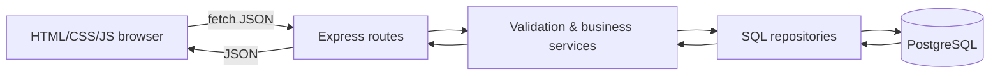

# SlotDrop system and data flow

SlotDrop connects a browser-based customer journey to an Express API and PostgreSQL. Sessions, bookings and payments are course-demo records; they do not reserve real studio inventory.

## Transaction: choose, quote, save, read back

| Hop | Code location | Behavior |
|---|---|---|
| 1. Browse | Home and Browse interface → `GET /api/slots` | Requests eligible sessions filtered by date, area, activity or party size |
| 2. Discover | `server/routes/slots.js` → `listSlots()` in `server/services/discovery.js` → `server/repositories/slots.js` | Filters active sessions, future cutoff, remaining released seats and discovery window; returns JSON |
| 3. Choose | `public/js/detail.js` and `public/js/selection.js` | Fetches detail and quantity-aware quote; displays the selected session and party price |
| 4. Quote | `server/routes/pricing.js` → `server/services/pricing.js` | Validates session and quantity; selects standard or buddy tier stored in DB, never browser money |
| 5. Submit | Checkout → `request('/api/bookings', {method:'POST', ...})` in `public/js/customer-common.js` | Sends session ID, quantity, fictional guest details, accepted quote and a stable UUID request ID |
| 6. Route | `server/routes/bookings.js` → `createBooking()` in `server/services/bookings.js` | Validates allowed fields, UUID, quantity, fictional contact fields and payment choice |
| 7. Transaction | `createBooking()`, `checkBookable()`, `priceQuote()` | Checks existing requestId; locks `slots` row with `SELECT ... FOR UPDATE`; rechecks available seats and eligibility after lock; recomputes tier/fee/total and checks expectedTotalCentavos |
| 8. Database save | `createBooking()` → SQL `INSERT INTO bookings ... RETURNING id` | Stores accepted price, time, quantity, fee and provider proceeds as immutable snapshots; commits atomic booking. Same normalized requestId returns existing receipt (HTTP 200), new booking HTTP 201 |
| 9. Receipt readback | `GET /api/bookings/:id` → `findReceipt()` | Reads saved receipt by UUID from PostgreSQL. Public payload omits private guest contact information and retry key |
| 10. Confirmation | Confirmation → `GET /api/bookings/:id` | Displays the persisted reference, activity, quantity and total by fetching the saved receipt |
| 11. Owner | `GET /api/bookings`, `GET /api/metrics` → `public/js/owner.js` | Reads saved booking list and five metrics from persisted confirmed bookings; a two-seat order counts as one booking |

All money is modeled in PHP centavos. The active commission setting lives in `server/config/business.js`; quote and booking both derive totals on the server. The selected quantity is **not** reserved when merely viewing Detail/Selection; save is the transaction that reduces remaining seats. The code derives remaining seats from released capacity minus confirmed booking quantities rather than persisting a mutable display counter.

## Owner offer-management path

1. `public/js/owner.js` sends `POST /api/slots` or `PATCH /api/slots/:id`; edits send only changed fields.
2. `server/routes/slots.js` calls `createOffer()` or `editOffer()` in `server/services/offers.js`.
3. The service validates cutoff/price/capacity, locks the relevant activity or slot and refuses edits conflicting with confirmed seats.
4. `server/repositories/slots.js` returns the updated offer and available-seat count.
5. Owner refreshes catalog, metrics and saved bookings. Prior confirmed receipts are not rewritten by later offers.
